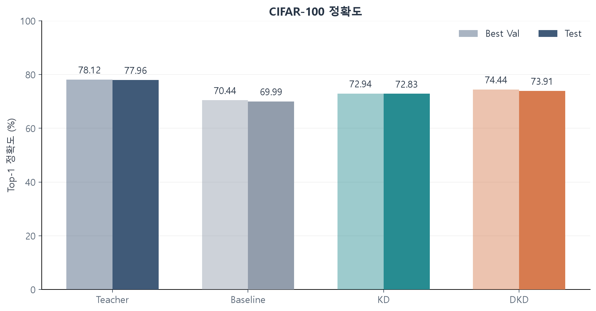
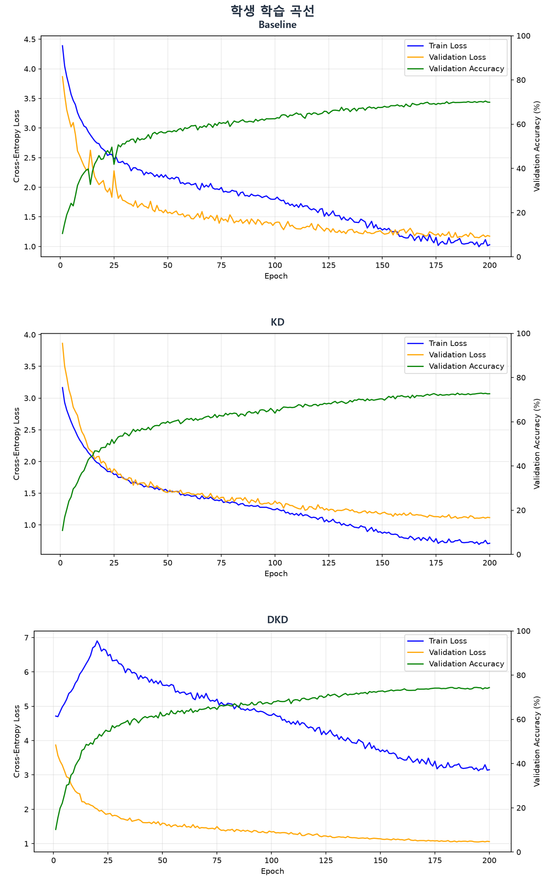
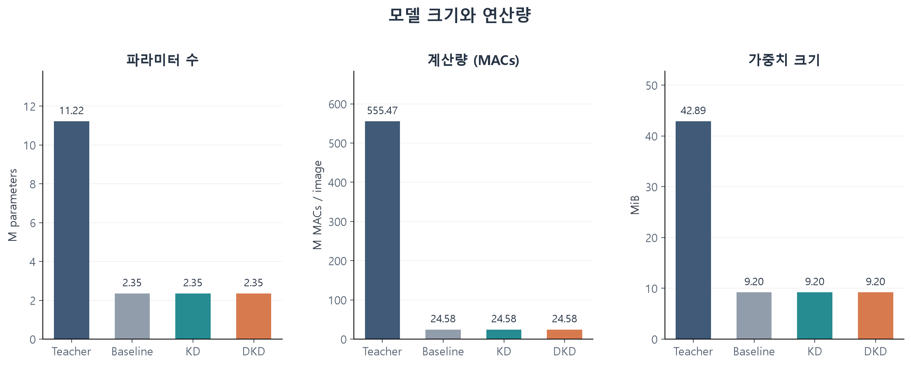
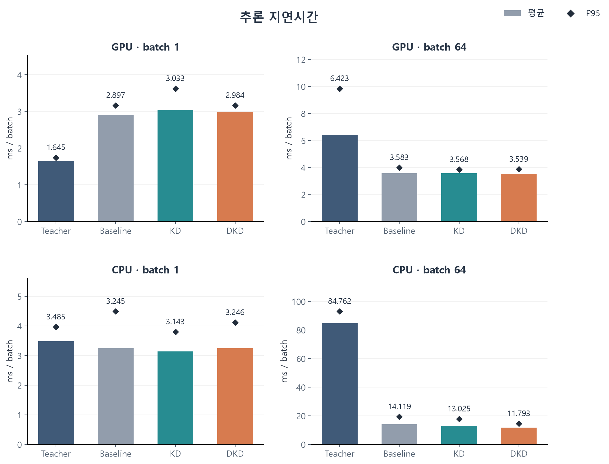
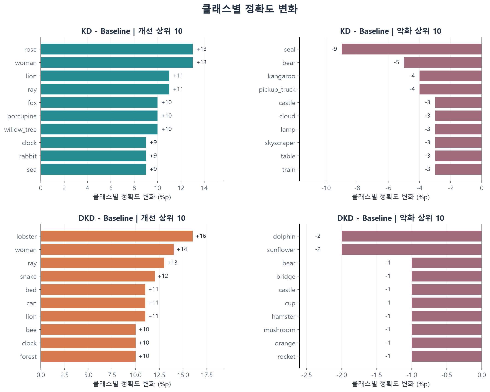
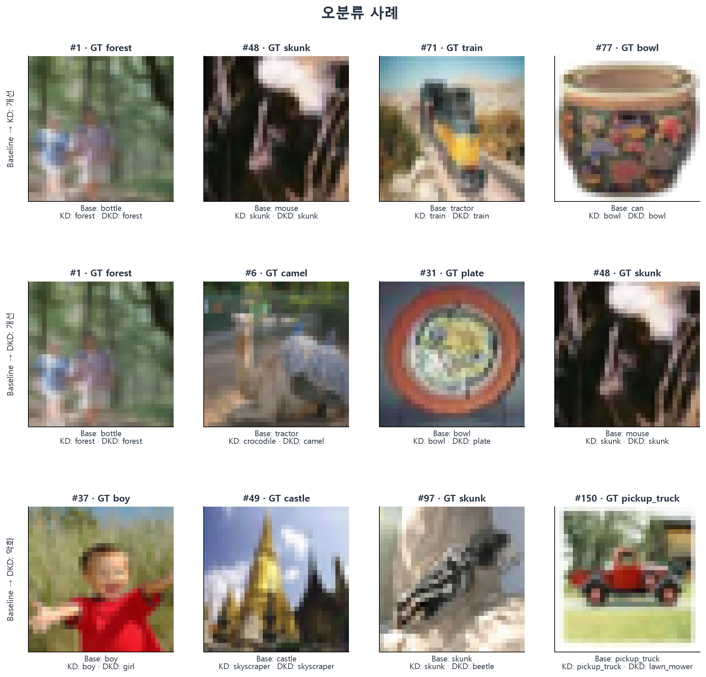

# CIFAR-100 CNN 지식 증류 실험 보고서

2026-10-27

## 1. 실험 상태와 초록

| 모델 | Best Val (%) | Test (%) | Parameters |
|---|---:|---:|---:|
| ResNet-18 Teacher | 78.12 | 77.96 | 11,220,132 |
| MobileNetV2 Baseline | 70.44 | 69.99 | 2,351,972 |
| MobileNetV2 + KD | 72.94 | 72.83 | 2,351,972 |
| MobileNetV2 + DKD | 74.44 | 73.91 | 2,351,972 |

직접 구현한 CIFAR용 ResNet-18과 MobileNetV2를 비교해, 작은 학생의 정확도 개선과 실행 비용을 함께 분석했다. 단일 seed 42 실행에서 DKD는 Baseline보다 **3.92%p** 높은 Test 정확도를 보였다. 학생의 파라미터는 교사보다 **79.04%** 적지만 GPU batch=1에서는 더 느렸고 batch=64에서는 더 빨랐다.


수치는 [종합 CSV](experiment_summary.csv)에 정리.

## 2. 서론과 연구 질문

CIFAR-100의 32×32 RGB 이미지 한 장에 100개 fine label 중 하나를 예측한다. 비교 대상은 직접 구현한 CNN과 로컬 교사 체크포인트다.

- **정확도:** 같은 MobileNetV2에서 KD와 DKD가 일반 CE 학습보다 개선되는가?
- **효율:** 작은 파라미터·MACs·가중치 크기가 CPU/GPU 지연시간 감소로 이어지는가?
- **오류:** 전체 정확도 변화는 어떤 클래스와 이미지의 개선·악화로 구성되는가?

문헌은 모델과 증류 방법의 근거로 참고했다. CIFAR용 구조 변경과 MixUp-DKD는 프로젝트 설정이므로, 원 논문의 전체 조건을 재현한 실험으로 해석하지 않는다.

## 3. 데이터셋과 전처리

[CIFAR-100](https://www.cs.toronto.edu/~kriz/cifar.html)의 공식 train 50,000장을 계층화 분할하고, 공식 test 10,000장을 평가에 사용했다.

| 분할 | 이미지 | 클래스당 | 용도 |
|---|---:|---:|---|
| Train | 45,000 | 450 | 학습·정규화 통계 |
| Validation | 5,000 | 50 | best 선택 |
| Test | 10,000 | 100 | 분류 평가 |

분할 기준은 [분할 코드](../../../scripts/inspect_cifar100.py)의 `train_test_split(test_size=0.1, random_state=42, stratify=labels)`.

- **저장 인덱스:** 각각 중복 없이 45,000/5,000개, 교집합 0, 합집합 50,000.
- **재생성 확인:** 현재 환경에서 인덱스 순서까지 일치.

정규화 통계는 Train 인덱스만 선택한 이미지를 float32로 바꾸고 255로 나눠 재계산했다. 채널별 결과는 저장본과 정확히 일치.

| 채널 | Mean | Std |
|---|---:|---:|
| R | 0.507058263 | 0.267241955 |
| G | 0.486423731 | 0.256333917 |
| B | 0.440586209 | 0.276031226 |

[전처리 코드](../../../src/data/cifar100.py)에서 확인한 구성:

- **Train:** `RandomCrop(32,padding=4) → RandomHorizontalFlip → RandAugment(2,9) → ToTensor → Normalize`..
- **Validation/Test:** 별도 Dataset 인스턴스에 `ToTensor → Normalize`만 적용.
- **Loader:** Train만 shuffle, 모든 학습 loader는 batch 64, workers 0.

네 학습 경로에서 공통으로 사용하는 [MixUp](../../../src/data/augmentation.py)은 정규화된 배치에 공유 계수 `λ~Beta(0.2,0.2)`와 무작위 순열을 적용한다.

## 4. 모델과 학습 프로토콜

### 4.1. 모델

[ResNet-18](../../../src/models/resnet.py)의 CIFAR 구성:

- 3×3/stride 1 stem, BasicBlock `[2,2,2,2]`.
- Stage 채널 `[64,128,256,512]`, GAP와 100-class head.
- 초기 MaxPool 제거, stride·채널 변경 시 projection shortcut 적용([ResNet](https://arxiv.org/abs/1512.03385)).

[MobileNetV2](../../../src/models/mobilenetv2.py)의 학생 구성:

- Expansion→depthwise 3×3→linear projection의 inverted residual.
- Stride 1 stem, 마지막 1280채널과 100-class head.
- 채널 고정, width multiplier 인자 없음.([MobileNetV2](https://arxiv.org/abs/1801.04381)).

| 모델 | Best epoch | 최종 epoch | 학습 목적 |
|---|---:|---:|---|
| Teacher | 194 | 200 | MixUp CE |
| Baseline | 198 | 200 | MixUp CE |
| KD | 185 | 200 | MixUp CE + KD |
| DKD | 194 | 200 | MixUp CE + DKD |

**모델 확인:** 네 best checkpoint의 CPU `strict=True` load와 `[1,3,32,32] → [1,100]` 검사 통과. 세 학생의 구조는 같고, 증류로 추가되는 추론 파라미터는 없다.

### 4.2. 학습 설정

교사는 [실행 코드](../../../scripts/train_cifar100_teacher.py)에서 따로 확인했다. 아래는 현재 네 스크립트의 공통 설정.

| 항목 | 값 |
|---|---|
| Epoch / seed | 200 / 42 |
| Batch / workers | 64 / 0 |
| Optimizer | SGD |
| LR / momentum / weight decay | 0.01 / 0.9 / 5e-4 |
| Scheduler | CosineAnnealingLR |
| T_max / eta_min | 200 / 1e-5 |
| RandAugment / MixUp α | (2,9) / 0.2 |

scheduler는 epoch마다 한 번 진행한다. 증류별 설정은 5절 참고.

### 4.3. 체크포인트

[EXPERIMENTS](../../../src/evaluation/cifar100_evaluate.py)

- **갱신 조건:** `val_acc > best_val_acc`일 때만 저장.
- **동점 처리:** 먼저 저장한 모델 유지.

<details>
<summary>체크포인트 경로</summary>

프로젝트 루트 기준.

| 모델 | best checkpoint |
|---|---|
| Teacher | `runs/cifar100_ResNet18_teacher_200_cosine_randaug_mixup0.2/best.pt` |
| Baseline | `runs/cifar100_MobileNetV2_student_200_cosine_randaug_mixup0.2/best.pt` |
| KD | `runs/cifar100_MobileNetV2_kd_200_cosine_randaug_mixup0.2_T4.0_kd_a0.5/best.pt` |
| DKD | `runs/cifar100_MobileNetV2_kd_200_cosine_randaug_mixup0.2_T4.0_dkd_a1.0_b8.0_warmup20/best.pt` |

- **최종 상태:** Teacher/Baseline의 `epoch200.pt`, KD/DKD의 `last.pt`에서 epoch 200 확인.
- **크기 구분:** 전체 best.pt에는 optimizer·scheduler·RNG도 포함. 모델 가중치 크기로는 사용하지 않았다.

</details>

## 5. 지식 증류 방법

학생·교사 logits를 `z_s`, `z_t`, temperature 분포를 `p_s^T=softmax(z_s/T)`, `p_t^T=softmax(z_t/T)`로 둔다. 정답 두 개를 혼합한 CE는 다음과 같다.

$$L_{CE,mix}=\lambda CE(z_s,y_a)+(1-\lambda)CE(z_s,y_b).$$

[일반 KD](https://arxiv.org/abs/1503.02531)의 [손실 구현](../../../src/losses/kd_loss.py)은 학생 `log_softmax`, 교사 `softmax`, `reduction=batchmean`으로 **교사→학생** KL을 계산한다.

$$L_{KD}=(1-\alpha)L_{CE,mix}+\alpha T^2 KL(p_t^T\Vert p_s^T),\quad T=4,\ \alpha=0.5.$$

[DKD](https://arxiv.org/abs/2203.08679)는 target/나머지의 이진 분포 KL(TCKD)과 target을 제외해 재정규화한 분포 KL(NCKD)을 분리한다. 두 항 모두 T²를 포함한다.

$$L_{DKD}=L_{CE,mix}+w_e(\alpha L_{TCKD,mix}+\beta L_{NCKD,mix}),\quad w_e=\min(e/20,1).$$

`e`는 1부터 시작하며 T=4, α=1, β=8이다. TCKD는 target logit·non-target logsumexp를, NCKD는 target masking −1e4를 사용한다. 각 항은 `y_a`, `y_b`에 대해 구한 뒤 λ와 1−λ로 합친다. **단일 MixUp 입력에 두 target을 적용한 프로젝트 변형**이다.

학습과 평가에서 구분할 부분:

- **입력:** 교사와 학생에 같은 MixUp 입력 전달.
- **교사 고정:** [학습 루프](../../../src/training/kd_trainer.py)의 `teacher.eval()`·`no_grad()`와 학생 전용 optimizer로 파라미터·BN 통계 고정.
- **평가 손실:** Validation/Test는 일반 CE.

일반 KD와 DKD는 CE 계수·증류 항·warmup도 다르다. 따라서 관찰한 차이에서 분해 방식만의 인과 효과를 분리할 수는 없다.

## 6. 분류 결과



정확도 차이만 따로 보면:

- KD−Baseline **+2.84%p**, DKD−Baseline **+3.92%p**.
- DKD−KD **+1.08%p**, Teacher−DKD 격차 4.05%p.

정확도는 %, 차이는 %p로 구분한다. Test 정답 한 장은 0.01%p.

[원본 summary](../../raw/cifar100/summary.csv)

| 모델 | Test 정답/10,000 | Test CE loss | Baseline 대비 (%p) |
|---|---:|---:|---:|
| Teacher | 7,796 | 0.902657 | +7.97 |
| Baseline | 6,999 | 1.155182 | 0.00 |
| KD | 7,283 | 1.091176 | +2.84 |
| DKD | 7,391 | 1.056746 | +3.92 |

원본 metrics: [Teacher](../../raw/cifar100/teacher/metrics.json) · [Baseline](../../raw/cifar100/baseline/metrics.json) · [KD](../../raw/cifar100/kd/metrics.json) · [DKD](../../raw/cifar100/dkd/metrics.json).

### 학생 학습 곡선



## 7. 효율과 추론 벤치마크

### 7.1. 모델 크기와 연산량

| 모델 | Parameters | 가중치 (MiB) | MACs/장 | 근사 FLOPs/장 |
|---|---:|---:|---:|---:|
| Teacher | 11,220,132 | 42.886485 | 555,468,800 | 1,110,937,600 |
| Baseline | 2,351,972 | 9.201182 | 24,576,512 | 49,153,024 |
| KD | 2,351,972 | 9.201182 | 24,576,512 | 49,153,024 |
| DKD | 2,351,972 | 9.201182 | 24,576,512 | 49,153,024 |

교사 대비 학생의 감소율:

- Parameters **79.0379%**.
- 가중치 직렬화 **78.5453%**.
- 해당 MACs **95.5755%**.

가중치는 `torch.save(state_dict, BytesIO)` 크기로 BN buffer·metadata를 포함한다. MiB=1024² bytes 기준([복잡도 원본](../../raw/cifar100/benchmark/model_complexity.csv)).



[측정 코드](../../../src/evaluation/cifar100_benchmark.py)는 Conv2d/Linear만 센다. Conv의 `Cin/groups`로 depthwise를 반영하고 BN·activation·pooling·residual/bias add·softmax·메모리 이동은 제외한다. FLOPs=2×MACs는 이 범위의 근사이며 [계층 합계](../../raw/cifar100/benchmark/layer_macs.csv)도 일치했다.

교사 `raw_tensor_mib=84.803146`은 공유 storage를 가진 state_dict 별칭 키의 중복 합이다. 같은 BasicBlock 모듈의 속성/Sequential 중복 등록을 확인했으며 실제 직렬화 **42.886485 MiB**를 채택했다. Params/MACs는 중복 제거 경로로 계산되어 이 문제로 두 배가 되지 않는다.

### 7.2. 추론 지연시간



그림의 **막대는 Mean, 마름모는 P95**이며 단위는 **ms/배치**다. Synthetic FP32 `[B,3,32,32]`, `eval()`·`inference_mode()`의 forward만 측정했다. DataLoader·전처리·H2D·모델 로딩은 제외한다. `1000×B/mean_ms`의 환산 images/s는 전체 서비스 throughput이 아니다.

측정 방식은 장치별로 구분했다.

- **GPU:** warmup 30회 후 동기화, CUDA event로 200회 측정.
- **CPU:** `perf_counter()`, warmup 5회, B1 50회·B64 10회.
- **스레드:** CPU intra-op threads 24는 당시 기록값.

<details>
<summary>GPU·CPU 상세 결과</summary>

**GPU** — 시간 ms/배치, 처리량 images/s, Peak allocated MiB.

| 모델 | Batch | Mean | Median | P95 | images/s | Peak MiB |
|---|---:|---:|---:|---:|---:|---:|
| Teacher | 1 | 1.6455 | 1.6378 | 1.7439 | 607.7 | 90.4595 |
| Baseline | 1 | 2.8972 | 2.8712 | 3.1642 | 345.2 | 42.8032 |
| KD | 1 | 3.0325 | 2.9625 | 3.6240 | 329.8 | 42.8032 |
| DKD | 1 | 2.9845 | 3.0026 | 3.1619 | 335.1 | 42.8032 |
| Teacher | 64 | 6.4231 | 5.6418 | 9.8491 | 9,964.0 | 171.7441 |
| Baseline | 64 | 3.5827 | 3.4778 | 3.9997 | 17,863.6 | 93.9297 |
| KD | 64 | 3.5680 | 3.5548 | 3.8441 | 17,937.5 | 93.9297 |
| DKD | 64 | 3.5392 | 3.5100 | 3.8704 | 18,083.0 | 93.9297 |

[GPU 원본](../../raw/cifar100/benchmark/gpu_latency.csv). Peak는 warmup 뒤 초기화한 PyTorch allocated 최고치로 모델·입력·임시 tensor를 포함한다. CUDA context·reserved cache·다른 프로세스까지 합한 장치 전체 메모리는 아니다.

**CPU** — 시간 ms/배치, 처리량 images/s.

| 모델 | Batch | Mean | Median | P95 | images/s |
|---|---:|---:|---:|---:|---:|
| Teacher | 1 | 3.4845 | 3.4681 | 3.9650 | 287.0 |
| Baseline | 1 | 3.2447 | 2.9266 | 4.4922 | 308.2 |
| KD | 1 | 3.1429 | 3.0297 | 3.8004 | 318.2 |
| DKD | 1 | 3.2464 | 3.1104 | 4.1157 | 308.0 |
| Teacher | 64 | 84.7620 | 85.7179 | 93.0645 | 755.1 |
| Baseline | 64 | 14.1194 | 13.1796 | 19.3295 | 4,532.8 |
| KD | 64 | 13.0251 | 12.0162 | 17.8452 | 4,913.6 |
| DKD | 64 | 11.7928 | 11.2980 | 14.5108 | 5,427.0 |

[CPU 원본](../../raw/cifar100/benchmark/cpu_latency.csv)
</details>

[저장 환경](../../raw/cifar100/benchmark/benchmark_environment.json): Windows 11, Python 3.13.16, PyTorch 2.14.1+cu130, RTX 5080 Laptop GPU.


## 8. 클래스별·오류 분석

### 8.1. 클래스별 변화

| 비교 | 개선 (클래스) | 동일 (클래스) | 악화 (클래스) |
|---|---:|---:|---:|
| Baseline → KD | 74 | 4 | 22 |
| Baseline → DKD | 83 | 5 | 12 |
| KD → DKD | 57 | 8 | 35 |

클래스별로 눈에 띄는 변화:

- **DKD−Baseline 개선:** lobster 49→65%(+16%p), woman 39→53%(+14%p), ray 52→65%(+13%p).
- **악화:** dolphin 65→63%·sunflower 93→91%, 각각 −2%p.
- **방법별 차이:** seal은 KD에서 40→31%(−9%p)로 악화했고 DKD에서는 43%.

클래스별 Test 100장에서 1%p는 정답 한 장.



클래스별 원본: [Baseline](../../raw/cifar100/baseline/class_accuracy.csv) · [KD](../../raw/cifar100/kd/class_accuracy.csv) · [DKD](../../raw/cifar100/dkd/class_accuracy.csv). 전체 혼동행렬: [Teacher](../../raw/cifar100/teacher/confusion_matrix.csv) · [Baseline](../../raw/cifar100/baseline/confusion_matrix.csv) · [KD](../../raw/cifar100/kd/confusion_matrix.csv) · [DKD](../../raw/cifar100/dkd/confusion_matrix.csv).

### 8.2. 혼동과 사례

주요 방향성 혼동은 Teacher의 girl→woman 22장, Baseline의 woman→girl 22장·maple_tree→oak_tree 21장, KD의 oak_tree→maple_tree 19장, DKD의 maple_tree→oak_tree 18장·mouse→shrew 17장이다. A→B와 B→A는 별도 오류이며 교사 출력에도 혼동이 남아 있다.

| 비교 | 오답→정답 | 정답→오답 | 순증 정답 | 변화 (%p) |
|---|---:|---:|---:|---:|
| Baseline → KD | 878 | 594 | 284 | +2.84 |
| Baseline → DKD | 956 | 564 | 392 | +3.92 |
| KD → DKD | 721 | 613 | 108 | +1.08 |

[동일 이미지 비교](../../raw/cifar100/model_comparison/predictions_comparison.csv) 10,000행과 [변화 수](../../raw/cifar100/model_comparison/change_counts.json)를 대조했다. DKD의 개선 956장과 회귀 564장을 함께 보고한다.



사례는 **Baseline 오답→KD 정답, Baseline 오답→DKD 정답, Baseline 정답→DKD 오답의 조건별 test_index 오름차순 첫 4장**이다. 별도의 원본 `misclassified_examples.png`는 고신뢰 오답 상위 사례다.

예측 로그에서 확인할 수 있는 사례:

- **개선:** index 6의 camel은 Baseline tractor·KD crocodile·DKD camel. Index 31의 plate는 Baseline/KD bowl·DKD plate.
- **회귀:** index 37의 boy는 Baseline/KD boy·DKD girl. Index 97의 skunk는 Baseline/KD skunk·DKD beetle.

## 9. 논의

이 단일 실행에서는 KD와 DKD가 학생 정확도를 개선했고 DKD가 1.08%p 더 높았다. 다만 모든 클래스·이미지의 개선은 아니며, CE 계수·증류 항·warmup 차이까지 함께 평가한 결과다.

정적 크기와 실행 비용도 구분해야 한다. GPU에서 DKD 학생은 교사보다 B1 약 **1.81배 느리고**, B64 약 **1.81배 빠르다**. 연산 구성·커널 오버헤드·GPU 활용도는 가능한 설명이지만 profiler로 원인을 검증하지 않았다. 세 학생의 추론 그래프는 같으므로 학생 간 작은 시간 차이를 증류 자체의 가속으로 해석하지 않는다.

## 10. 한계와 타당성 위협

- **반복 실험:** Seed 42만 있어 seed 분산·p-value·유의성·일반적 우월성은 미검증이다.
- **적용 범위:** CIFAR-100 32×32·한 노트북의 결과이며 다른 데이터·해상도·장치로 외삽하지 않는다. MixUp-DKD는 프로젝트 변형이다.

## 11. 재현 절차

현재 감사 환경:

- Python 3.13.16, PyTorch 2.14.1+cu130, torchvision 0.29.1+cu130.
- NumPy 2.5.2, Matplotlib 3.11.2, Pillow 12.3.0, CUDA runtime 13.0.

설치와 fresh Teacher wrapper는 [README](../../../README.md) 참고.

**재실행은 기존 결과가 없는 별도 clone/복사본에서 수행.**

- 학습: 같은 run의 체크포인트·곡선을 다시 저장.
- 평가·벤치마크: `reports/raw/`를 다시 저장.


<details>
<summary>실행 명령과 전제</summary>

프로젝트 루트 기준.

```powershell
python -m scripts.inspect_cifar100
python -m scripts.train_cifar100_student
python -m scripts.train_cifar100_kd
python -m scripts.train_cifar100_dkd
python -m src.evaluation.cifar100_evaluate
python -m src.evaluation.cifar100_benchmark
```

실행 전에 확인할 전제:

- `python -m scripts.train_cifar100_teacher`는 기존 best.pt 재개. Checkpoint 없는 clone에서는 바로 동작하지 않는다.
- 새 교사 학습은 README의 메모리 내 설정 wrapper 사용.
- KD/DKD는 지정된 교사 best가 먼저 필요.
- Loader는 `download=False`이므로 데이터·split·통계를 준비.

분할 파일은 `data/splits/cifar100_train_idx.npy`, `cifar100_val_idx.npy`, 통계는 `data/stats/cifar100_stats.npz`다. 다운로드 데이터·checkpoint·split/stat은 clone에 자동 동봉되지 않는다. 원본 raw가 있는 로컬 환경에서는 CSV와 상대 링크로 수치를 확인할 수 있다.

</details>


## 12. 결론

이 실행에서 KD는 Baseline보다 2.84%p, DKD는 3.92%p 높은 Test 정확도를 보였다. DKD는 83개 클래스에서 개선됐지만 악화도 남았다. 학생은 파라미터 79.04%·해당 MACs 95.58%를 줄였으나 지연시간의 이점은 배치에 따라 달랐다. 정확도·정적 복잡도·실제 지연시간을 분리해 평가해야 한다.


## 13. 참고문헌

1. Krizhevsky. [CIFAR-10 and CIFAR-100 datasets](https://www.cs.toronto.edu/~kriz/cifar.html).
2. He et al. [Deep Residual Learning for Image Recognition](https://arxiv.org/abs/1512.03385).
3. Sandler et al. [MobileNetV2: Inverted Residuals and Linear Bottlenecks](https://arxiv.org/abs/1801.04381).
4. Hinton et al. [Distilling the Knowledge in a Neural Network](https://arxiv.org/abs/1503.02531).
5. Zhao et al. [Decoupled Knowledge Distillation](https://arxiv.org/abs/2203.08679).
